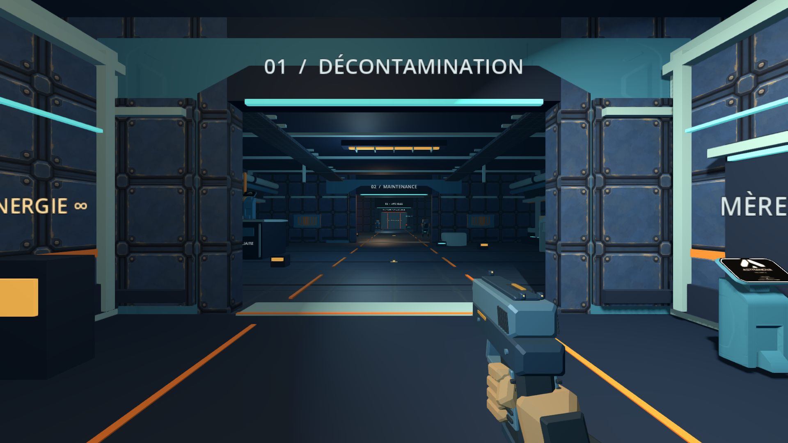
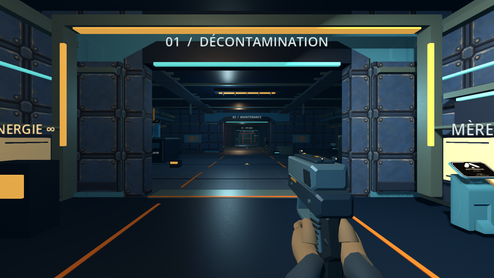
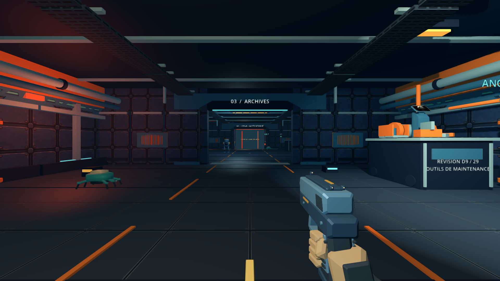
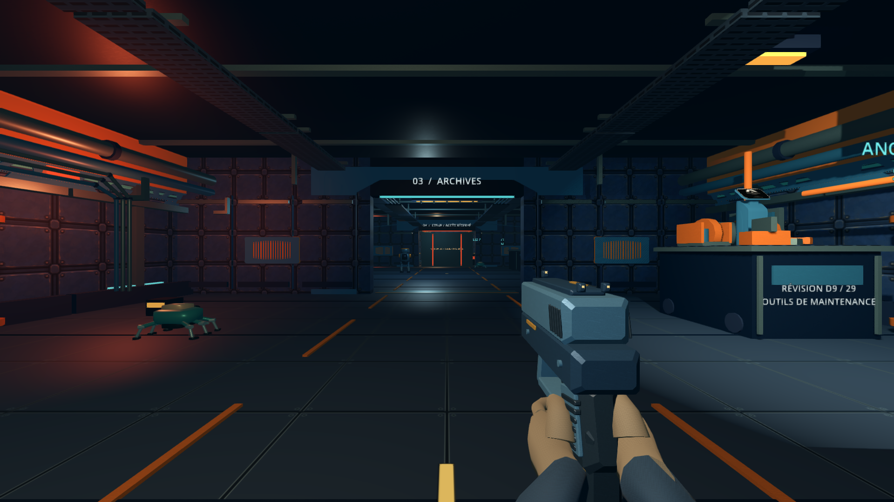
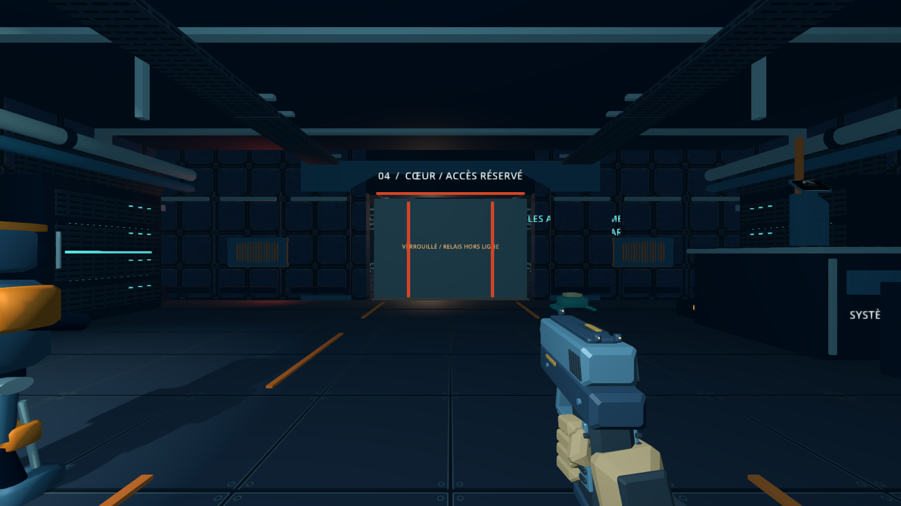
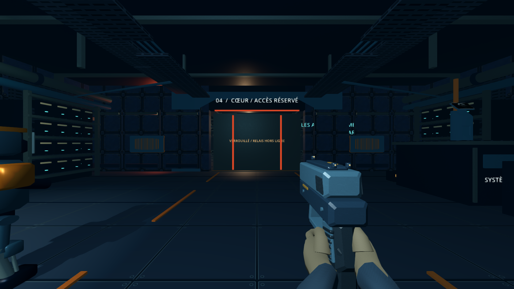
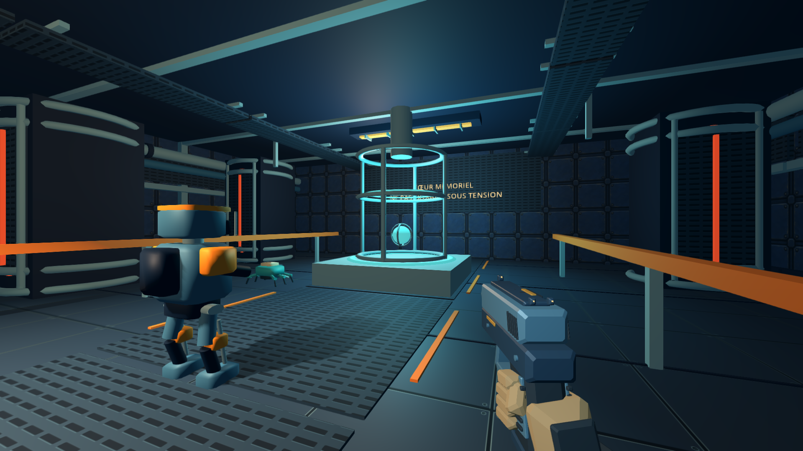
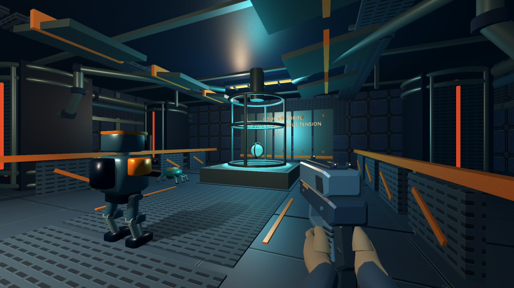
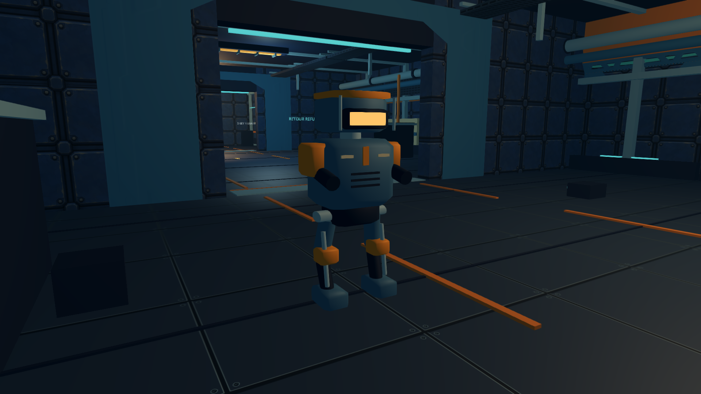
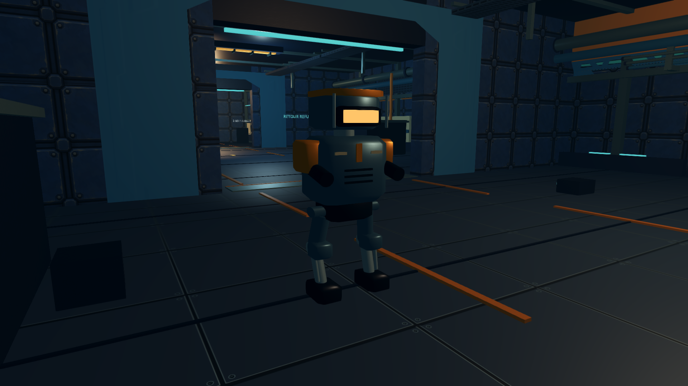

# Mission Astra : rendu et animations

Cette branche reprend le prototype `30ce447` de la PR #88 et le rig local déjà commité jusqu’à `301c2fd`. Elle conserve Godot 4.7.2, Compatibility, les dégâts, portées et cadences des armes, la batterie ARC-3/Scan Écho et les collisions du niveau.

## Place dans les PR ouvertes

La livraison Astra s’appuie sur le rig de la [PR #90](https://github.com/charlescstpierr/silo9-/pull/90), elle-même empilée sur [#88](https://github.com/charlescstpierr/silo9-/pull/88). Ces PR ont été revérifiées avant publication.

La [PR #91](https://github.com/charlescstpierr/silo9-/pull/91), publiée en parallèle pendant la mission, propose une autre recharge D9 de 2,60/3,25 secondes. Astra conserve 1,35 seconde. Une simulation Git sans modifier le worktree confirme des conflits dans `fps_rig.gd`, `player.gd`, `player_audio.gd` et `weapon_visual.gd`. Les deux PR sont donc des variantes concurrentes sur ces fichiers. Leur intégration commune exige un choix de recharge et une nouvelle vérification ; aucune fusion n’a été tentée dans le worktree ni publiée.

## Changements visibles

Les mains utilisent le squelette existant de 35 os et deux surfaces skinnées, soit 2 400 triangles. Les prises et les courbes des doigts ont été corrigées. Les gants et les manches reçoivent une trame textile mate, tandis que les armes et les robots utilisent une rugosité et des rayures de métal distinctes.

Le D9 possède maintenant deux chargeurs physiques et une culasse mobile avec ses mires et stries. La main gauche extrait le chargeur, le descend vers la poche hors champ, remonte le remplacement, l’insère et réarme si le chargeur initial était vide. Les doigts se desserrent et reprennent contact. La durée reste de 1,35 seconde.

| Moment | Animation et état |
| --- | --- |
| Début | Le joueur valide la réserve et capture l’état vide/partiel. |
| Extraction | La main suit le chargeur. Un clic accompagne le retrait. |
| Échange | Les deux chargeurs échangent leur visibilité hors champ. |
| Insertion | Le chargeur remonte avec la main et se verrouille. |
| Réarmement à vide | La main saisit la culasse et la relâche. La recharge partielle saute ce geste. |
| Fin | Le rig reçoit la pose finale, puis RunState transfère exactement les cartouches manquantes une seule fois. |

Une seule horloge, dans le joueur, pilote la progression, les poses et les sons. Un changement d’arme, une désactivation, une téléportation ou la mort annule la transaction. Le viewmodel descend avant de restaurer ses pièces hors champ, puis remonte pendant une récupération de 0,38 seconde. Le tir et une nouvelle recharge attendent la fin de cette récupération. La pause conserve son comportement précédent : elle annule la recharge.

L’ARC-3 affiche une impulsion cyan et une émission qui suit sa batterie réelle. Un tir accepté dépense 12 points et le Scan Écho 20 points dans la même réserve. Aucun chargeur de balles ou réservoir ARC supplémentaire n’est créé.

Les Sentinelles et Rampants fléchissent leurs genoux et orientent leurs pieds. Leur corps réagit à la vitesse réelle, au virage, à la recherche, à l’attaque et aux impacts. N-7 reçoit une animation de repos. Ces mouvements restent sur les nœuds visuels, sans déplacer la collision de gameplay.

Le refuge reçoit un cadre lumineux chaud, des protections claires et une main courante. La maintenance ajoute panneaux de service, conduites bridées et câbles. Les archives comportent des baies segmentées et chemins de câbles. Le réacteur reçoit conduites coudées, grilles et protections thermiques. Le regroupement statique par secteur et matériau reste en place, avec un seul projecteur d’ombre.

## Captures comparatives

Les images proviennent du viewport du jeu, à 1 920 × 1 080, avec positions, rotations et FOV identiques. Le monde est figé pour comparer le rendu. Ces images ne mesurent pas la fluidité. La caméra du réacteur a été déplacée de la même façon dans les deux versions : sa première position traversait une Sentinelle figée et masquait le cœur.

| Vue | Prototype avant | Mission Astra après |
| --- | --- | --- |
| Refuge |  |  |
| Maintenance |  |  |
| Archives |  |  |
| Réacteur |  |  |
| Sentinelle |  |  |

## Démonstration FPS

La [vidéo des mains et du rechargement](astra/fps-demo.mp4) montre marche, sprint, rapprochement de visée, tir D9, recharges partielle et vide, interruption, passage à l’ARC-3 et Scan Écho.

Le jeu rend chaque image avec une simulation fixée à 30 images par seconde, puis FFmpeg assemble ces images. La vidéo dure 8,93 secondes et contient 268 images à 1 280 × 720. Elle est silencieuse. Elle prouve l’enchaînement des actions et des poses, pas une exécution temps réel à 30 FPS sur cette machine. Le scénario initialise les cartouches et l’énergie pour montrer les cas demandés. Les actions passent ensuite par les véritables méthodes du joueur. Les ressources observées passent de 11/72 à 12/71 pour la recharge partielle, de 0/71 à 12/59 à vide, puis de 100 à 88 et 68 points pour le tir ARC suivi du Scan.

Les [manifestes des preuves](astra/evidence.json) conservent les caméras, les ressources pendant la démonstration, les versions et les empreintes des sources et médias. Les sorties initiales contenant des imports incomplets ou une caméra obstruée sont exclues des preuves livrées.

## Vérifications

Les [revues indépendantes](astra/reviews.md) couvrent le code, les images, les outils et les données livrées.

`./tools/verify.sh` passe dix suites sans erreur moteur : dialogue, rig FPS, parcours complet, contrôleur, recharge animée, robots, état/sauvegarde, interface, géométrie et monde. Les [résultats bruts](astra/verify.log) sont conservés.

Les cycles rouge puis vert couvrent les pièces mobiles absentes, la pose mécanique au transfert, les genoux manquants, les doigts qui pénétraient les armes, les réglages graphiques des mains et les sons de recharge. Les [preuves ciblées](astra/regressions.txt) conservent leurs sorties.

Les tests contrôlent chargeur vide/partiel, petite réserve, grand pas de temps, transfert unique, annulations et consommation ARC/Scan. Le test anatomique examine 320 centres articulaires et de doigts déformés contre les triangles des armes. Il ne prouve pas l’absence universelle d’intersection de chaque sommet de peau. Les images restent une vérification distincte.

Les matériaux retournent à leur état normal après le profil léger. Les six nouvelles cartes sont de 256 × 256 pixels, avec mipmaps. Le générateur les reproduit à l’octet près. Le jeu ne dépend ni de Python, ni de Blender, ni d’un nouvel addon. Les [provenances et choix open source](ASTRA_OPEN_SOURCE.md) détaillent ce qui est intégré et ce qui a été écarté.

## Performances mesurées

Vingt exécutions du binaire Linux release : cinq passages alternés par version et par profil, en Compatibility à 1 920 × 1 080. Même Godot 4.7.2 et même instrumentation dans les deux builds. Le [rapport complet](astra/performance.json) contient les mesures brutes, p95, étendues, durées, compteurs et SHA-256 des binaires. Les [journaux moteur](astra/performance-logs.txt) accompagnent les résultats.

Chaque station attend 1,5 seconde, puis mesure pendant au moins trois secondes et vingt images. Les fenêtres retenues durent de 3,00 à 5,14 secondes et contiennent 20 à 55 images. Les ennemis bougent et attaquent. Le benchmark rétablit artificiellement la santé à 100 avant chaque frame pour maintenir la sonde stationnaire en vie. Cette règle est identique dans les deux builds et ne s’applique pas au jeu normal.

Les valeurs suivantes sont les médianes des p50 en millisecondes ; les crochets indiquent le minimum et le maximum des cinq passages.

| Profil | Secteur | Avant, ms | Après, ms |
| --- | --- | ---: | ---: |
| Normal | ASCENSEUR / REFUGE | 163.5 [150.7–231.1] | 191.2 [187.5–196.7] |
| Normal | 02 / MAINTENANCE | 175.2 [160.2–248.9] | 199.5 [186.9–208.9] |
| Normal | 03 / ARCHIVES | 154.9 [147.2–220.1] | 195.3 [186.6–217.8] |
| Normal | 04 / CŒUR | 133.3 [129.3–194.8] | 165.4 [160.9–171.1] |
| Léger | ASCENSEUR / REFUGE | 78.8 [77.4–83.9] | 95.1 [91.7–103.2] |
| Léger | 02 / MAINTENANCE | 70.8 [68.9–74.6] | 85.3 [80.9–91.4] |
| Léger | 03 / ARCHIVES | 68.8 [66.4–72.1] | 79.1 [76.7–93.2] |
| Léger | 04 / CŒUR | 55.2 [54.0–59.2] | 65.8 [64.9–74.8] |

Le supplément de détail a un coût observé sur ce renderer logiciel. Le profil léger reste moins coûteux que le profil normal, mais ses médianes augmentent aussi. Le serveur possède huit processeurs logiques et partage sa charge avec d’autres travaux Godot. L’affichage X11 dédié évite les conflits de souris, sans réserver les cœurs CPU. Les étendues se recouvrent dans plusieurs mesures normales ; aucune différence GPU matérielle n’est déduite de ces résultats.

Appels de rendu et triangles en qualité normale, médianes des cinq passages :

| Secteur | Appels avant | Appels après | Triangles avant | Triangles après |
| --- | ---: | ---: | ---: | ---: |
| ASCENSEUR / REFUGE | 326 | 349 | 52576 | 61672 |
| 02 / MAINTENANCE | 342 | 356 | 102463 | 114107 |
| 03 / ARCHIVES | 196 | 223 | 66820 | 88924 |
| 04 / CŒUR | 70 | 89 | 45868 | 53612 |

| Profil | RSS maximal avant | RSS maximal après |
| --- | ---: | ---: |
| Normal | 794.4 Mio | 852.1 Mio |
| Léger | 700.4 Mio | 750.5 Mio |

Le RSS est le maximum du processus entier, démarrage compris. Ce n’est pas la mémoire GPU ni une mesure de fuite. Le compteur mémoire interne Godot est indisponible en release. Le temps CPU total représente environ quatre à cinq cœurs occupés, cohérent avec le renderer llvmpipe annoncé par le moteur.

Limites : le pilote refuse la modification de VSync ; sa désactivation est seulement demandée. Les caméras restent fixes et la physique du joueur est désactivée, donc cette série ne mesure pas le coût CPU des gestes FPS en mouvement. Une station plus lente reste active plus longtemps pour recueillir vingt images, ce qui peut changer les positions des ennemis. Les compteurs correspondent donc au travail réellement rendu, pas à un microbenchmark de géométrie strictement identique. Les petits échantillons p95 ne certifient pas les saccades rares.

**Objectif 60 FPS en 1080p : non atteint sur llvmpipe et non certifié sur GPU Windows.** L’export Windows x64 est produit et identifié comme PE32+, mais n’a pas été exécuté.

Pour reproduire cette comparaison, copier le `scripts/benchmark.gd` courant dans le snapshot `30ce447`, importer et exporter les deux projets avec les mêmes modèles release officiels. Le reste du code et des assets du snapshot doit rester inchangé. Exécuter ensuite :

```bash
DISPLAY=:98 python3 tools/compare_astra.py \
  --project /chemin/silo9-astra --baseline-project /chemin/baseline \
  --binary /chemin/silo9-astra/builds/linux/SILO9.x86_64 \
  --baseline-binary /chemin/baseline/builds/linux/SILO9.x86_64 \
  --output /chemin/preuves-vides --runs 5
```

## Reproduire les preuves

Définir `GODOT_BIN` si le moteur n’est ni dans `.tools/`, ni dans le PATH. L’import doit être terminé avant de lancer les captures. Un serveur X11 est nécessaire pour rendre les images.

```bash
./tools/verify.sh
DISPLAY=:97 python3 tools/prove_astra.py --output .cstack/astra-views --mode scenes
DISPLAY=:97 python3 tools/prove_astra.py --output .cstack/astra-demo --mode demo
DISPLAY=:97 python3 tools/prove_astra.py --output .cstack/astra-forward --mode scenes --renderer forward_plus
```

Chaque dossier de sortie doit être vide. Pour comparer au prototype, extraire `git archive 30ce447` dans un dossier séparé, y copier `tools/astra_probe.gd`, importer ce projet et passer son chemin avec `--project`. Le jeu ne charge jamais cette copie pendant une partie normale.

Le prototype Forward+ utilise uniquement l’option de lancement. Cinq vues ont été rendues sous Vulkan avec Godot 4.7.2, sur llvmpipe, sans modifier `project.godot`. La [capture du réacteur en Forward+](astra/forward-reactor.png) et son [manifeste](astra/forward-evidence.json) proviennent de la version finale. Aucun gain matériel, éclairage volumétrique ou avantage de performance n’est déduit de cet essai. Compatibility reste le profil livré.

## Limites et tickets

| Tickets | Livré ici | Reste ouvert |
| --- | --- | --- |
| [#2](https://github.com/charlescstpierr/silo9-/issues/2), [#3](https://github.com/charlescstpierr/silo9-/issues/3) | Rig skinné repris, prises corrigées, chargeurs/culasse animés, synchronisation et vidéo. | Anatomie encore stylisée et procédurale; validation humaine des gestes, notamment toutes les transitions. |
| [#4](https://github.com/charlescstpierr/silo9-/issues/4) | Impulsion énergétique et indicateurs liés à la batterie commune. | Utilisation des cellules d’inventaire toujours instantanée; aucun remplacement physique de cellule. |
| [#5](https://github.com/charlescstpierr/silo9-/issues/5), [#6](https://github.com/charlescstpierr/silo9-/issues/6), [#7](https://github.com/charlescstpierr/silo9-/issues/7) | Recul angulaire, culasse, effets D9/ARC distincts et poses du rig. | Sélection logique d’arme immédiate avec transition de soutien, douilles et options de confort supplémentaires, ADS balistique complet. |
| [#8](https://github.com/charlescstpierr/silo9-/issues/8), [#9](https://github.com/charlescstpierr/silo9-/issues/9), [#10](https://github.com/charlescstpierr/silo9-/issues/10) | PBR léger, détails des quatre secteurs, lumière motivée et profils. | Mesures GPU matériel/Windows, validation des variations de courant et finition des surfaces répétitives. |
| [#11](https://github.com/charlescstpierr/silo9-/issues/11) | Le rig peut servir de base aux gestes. | Animations des interactions portes/terminaux/ramassage non réalisées dans cette tranche. |
| [#80](https://github.com/charlescstpierr/silo9-/issues/80), [#81](https://github.com/charlescstpierr/silo9-/issues/81), [#84](https://github.com/charlescstpierr/silo9-/issues/84) | Licences, comparaison d’architecture et réutilisation des kits déjà présents. | Pas d’import de robot Sci-Fi Essentials ni d’adoption globale d’un template FPS. |
| [#89](https://github.com/charlescstpierr/silo9-/issues/89) | Tranche visuelle vérifiée et preuves réutilisables. | Roadmap gameplay/narration, tests joueurs et certification matérielle. |

Aucun de ces tickets n’est fermé automatiquement. Cette livraison améliore le prototype; elle ne certifie pas une finition équivalente à Fortnite.
