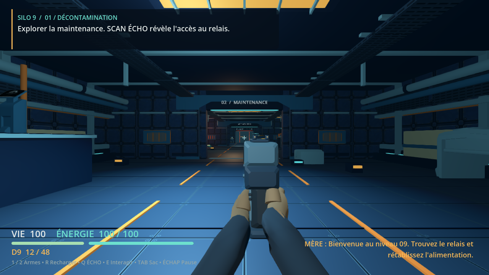
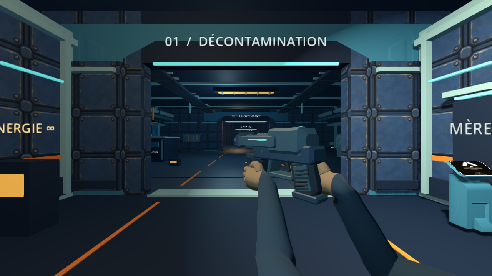

# Mains et avant-bras du ticket 2

Le contrôleur utilise deux mains gantées et deux bras déformés par un `Skeleton3D`. Les armes ne contiennent plus les anciennes mains fusionnées. Les matériaux des bras sont mats, non métalliques et sans émission. Le clic droit rapproche la prise. Il ne modifie ni la précision, ni le champ de vision. L'ADS complet appartient au ticket 7.

## Propriété et repères

`SiloPlayer` conserve les déplacements, la caméra, les raycasts, les ressources, le délai de tir et l'unique horloge de recharge. Il réutilise `SiloFpsRig.ViewFrame`, avec une pose `REST`, `RUN` ou `AIM`, la progression de recharge, le recul et le mouvement de marche.

`SiloFpsRig` possède les transforms des bras, des armes et de la bouche. L'arme logique et le modèle visible changent immédiatement ensemble. La main gauche suit une trajectoire de dégagement de 0,22 seconde. Le tir n'attend pas cette transition. La mort, la désactivation et la téléportation restaurent la prise courante.

Les modèles exposent `GripRight`, `GripLeft` et `Muzzle`. L'échelle 0,76 et le décalage historique restent sur le modèle d'arme. Le montage sous `BoneAttachment3D` utilise l'inverse du repère droit déjà transformé par le modèle, avec sa base orthonormalisée. Il conserve donc l'échelle de géométrie sans la compenser deux fois. Le rig résout main droite, montage, main gauche et bouche dans le même appel.

Les bras mesurent 0,32 m et les avant-bras 0,30 m. Le solveur place le coude vers le bas et l'extérieur. Une cible inaccessible échoue à la calibration et laisse les os dans leur pose précédente. Elle n'étire pas les segments.

## Géométrie originale

Le modèle est construit une fois au démarrage par sections elliptiques. La manche continue jusqu'à l'épaule, hors du cadre FPS. Les sections de manche et de gant se rejoignent au même anneau. Les poids mélangent avant-bras et main autour du poignet. Les quatre doigts ont des longueurs distinctes. Le pouce est opposé et la main droite présente son index vers la détente.

Le squelette contient 35 os.

| Côté | Bras | Avant-bras | Main | Phalanges des quatre doigts | Pouce |
|---|---|---|---|---|---|
| Droit | 1 | 2 | 3 | 4 à 15 | 16 et 17 |
| Gauche | 18 | 19 | 20 | 21 à 32 | 33 et 34 |

L'os 0 est la racine. Les deux bras réunis comptent 1 564 sommets, 2 400 triangles et deux surfaces. Le budget est de 24 000 sommets, 16 000 triangles et 48 os. L'arme visible ajoute cinq surfaces. Aucune géométrie ni aucun matériau n'est reconstruit pendant `update_visual()`.

L'ARC possède une poignée de support reliée au corps sous le canon. Un rayon depuis la paume gauche vérifie un contact avec les triangles réels de ce support, en plus des tests de marqueurs.

La poignée commune a été ramenée à 4,94 cm de large et 10,26 cm de haut pour correspondre aux mains. Les dimensions des armes n'influencent pas les raycasts de dégâts. Le contrôle géométrique a aussi révélé des triangles dégénérés dans les anciens petits biseaux. Leur rayon de coin est maintenant borné par la section disponible.

## Vérifications reproductibles

```bash
./tools/verify.sh
DISPLAY=:97 python3 tools/prove_fps_rig.py --video --inspect
DISPLAY=:97 python3 tools/prove_fps_rig.py --measure --baseline .cstack/issue-02/baseline-source --runs 5
```

La copie de référence peut être préparée sans modifier le checkout courant.

```bash
mkdir -p .cstack/issue-02/baseline-source
git archive 30ce44768d45d976d45f51caa2503cece08e23c1 | tar -x -C .cstack/issue-02/baseline-source
cp tools/probe_fps_rig.gd .cstack/issue-02/baseline-source/tools/probe_fps_rig.gd
./tools/godot.sh --headless --path .cstack/issue-02/baseline-source --editor --import --quit
```

Le troisième appel attend une copie de la base `30ce44768d45d976d45f51caa2503cece08e23c1`, importée par le même Godot, avec `tools/probe_fps_rig.gd` copié depuis la branche courante. Les preuves locales se trouvent dans `.cstack/issue-02/proof/`. Le script enregistre les empreintes SHA256 des sources, la résolution, le backend, les sorties Godot et les mesures brutes.

Les huit suites vérifient les régressions de gameplay et le nouveau rig. Le test de rig échantillonne 186 états de pose, recharge et recul pour les deux armes. Il vérifie contacts à 2 mm et 2 degrés, longueurs constantes, origine de bouche dans le même tick, changements répétés, interruptions et refus d'une cible impossible. Le contrôle géométrique parcourt récursivement toutes les surfaces et vérifie indices, normales, triangles, poids normalisés et indices d'os.

Le test initial échouait sur les six marqueurs absents avant l'implémentation. Le contrôle des triangles a échoué avant la correction des biseaux. Un test a ensuite reproduit une progression de recharge visuelle périmée dans le tick du changement d'arme. La correction remet cette progression à -1 dans l'annulation autoritaire. Les assertions de visée et d'annulation du nouveau rig ont été ajoutées après leur implémentation. Elles fournissent une preuve de régression, pas une preuve complète de développement test-first.

La vidéo utilise le jeu et les vraies actions du contrôleur. Elle montre chaque arme au repos, en marche, en course, en visée, au tir et lors de changements rapides. Le D9 effectue sa recharge temporisée existante. L'ARC refuse cette recharge et consomme 12 points d'énergie au tir. Les manipulations de chargeur et de cellule restent aux tickets 3 et 4. Des captures en maintenance montrent aussi les gants dans une zone plus sombre.

## Limites des mesures

La scène comparée est l'ascenseur, à 1 280 × 720, en qualité normale, sous Godot 4.7.2 Compatibility. Le serveur utilise llvmpipe. Il n'y a aucune mesure de GPU matériel ni preuve d'exécution Windows.

La comparaison avant/après conserve tout le jeu visible. Le masque des mains est disponible uniquement sur le nouveau rig. Il masque les deux surfaces skinnées, conserve les armes et continue les mises à jour de squelette. Le temps `rig_update_call_p50_ms` mesure un appel CPU à `update_visual()`. Il ne mesure pas le CPU total d'une image de gameplay à 60 Hz. Les temps d'image incluent le rendu logiciel et l'attente du pilote. Ils ne constituent pas des temps GPU.

Cinq exécutions par version ont alterné avant puis après, sans enregistrement vidéo concurrent. La médiane du temps d'image ne montre pas de différence mesurable au regard de la dispersion des runs.

| Arme et scène | Médiane des p50 | Étendue des p50 | Appels de dessin | Triangles |
|---|---|---|---|---|
| D9, base visible | 94,330 ms | 88,441 à 99,322 ms | 326 | 52576 |
| D9, rig visible | 93,952 ms | 91,045 à 103,256 ms | 327 | 54080 |
| D9, mains masquées | 91,778 ms | 88,919 à 94,999 ms | 325 | 51680 |
| ARC, base visible | 92,946 ms | 90,972 à 98,148 ms | 326 | 53346 |
| ARC, rig visible | 92,283 ms | 91,106 à 97,044 ms | 326 | 54138 |
| ARC, mains masquées | 92,146 ms | 88,993 à 95,125 ms | 324 | 51738 |

Un appel de mise à jour du rig prend une médiane de 0,120 ms pour chaque arme. Les médianes par run vont de 0,113 à 0,123 ms pour le D9, et de 0,119 à 0,124 ms pour l'ARC. Le masque retire exactement deux appels de dessin et 2 400 triangles. Les temps d'image varient davantage entre runs que l'écart des médianes avant/après. Ces résultats concernent le rendu logiciel d'une seule scène. Ils ne remplacent pas le benchmark global ni une validation à 60 FPS sur matériel cible.

Les mesures finales portent sur le code `f00711f7b60539b11bcfe190541cefa3520c8ad1`, comparé à `30ce44768d45d976d45f51caa2503cece08e23c1`. Les empreintes de chaque source sont conservées. Les ennemis restent actifs dans la scène. Les compteurs décrivent les images observées, pas uniquement le modèle FPS.

Les images, la vidéo et les contrôles géométriques sont des critères distincts. Les écarts de prise mesurés ne prouvent pas l'absence de pénétration. La qualité anatomique reste soumise à la revue visuelle indépendante du ticket.

## Preuves consultables

La [vidéo FPS de 23,6 secondes](media/02/fps-rig.mp4) montre le parcours exécuté dans le jeu à 1 280 × 720. Le fichier pèse environ 4,6 Mio. Les premières secondes montrent le chargement Godot. Le parcours n'est pas une mesure de performance.

La capture D9 montre la pose de visée produite par le contrôleur.



La vue latérale ARC est une vue de contrôle du rig dans le moteur. Elle montre la poignée de support saisie par la main gauche.



Le [résumé et les mesures brutes](media/02/performance.json) distinguent les deux armes et le masque des mains. Le [manifeste SHA256](media/02/source-manifest.json) identifie les sources et les médias correspondants.
