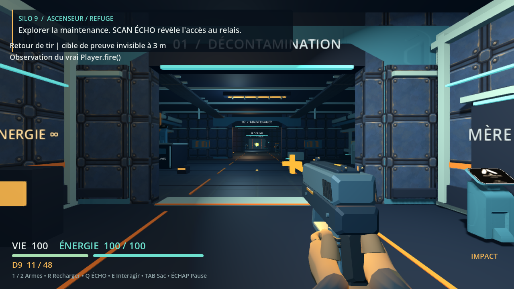
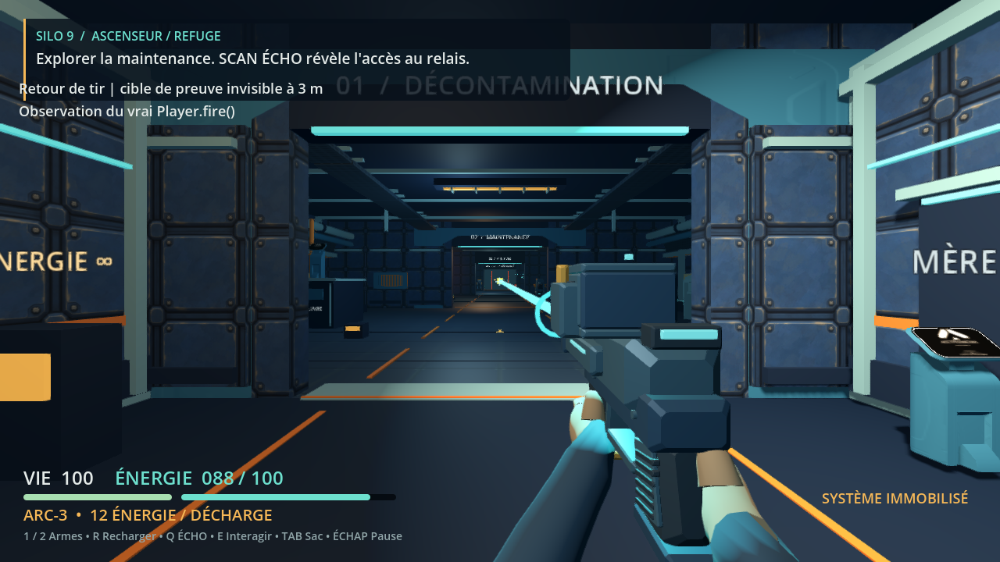

# Ticket 6 : départs de tir et douilles

Le D9 produit un flash orange et une douille. L’ARC produit une couronne cyan qui grandit autour du faisceau. Le recul revient progressivement à la pose de repos. Les rayons, dégâts, cadences et consommations restent ceux des armes existantes.

Un tir accepté conserve sa présentation jusqu’au premier dessin. Le test reproduit l’ancien défaut : après plusieurs ticks avant le dessin, la munition était consommée mais le flash avait disparu. Les images finales montrent le départ à la première image après le même délai.

Les réglages proposent une impulsion caméra et une intensité des départs/faisceaux de 0 à 100 %. Ils restent dans settings.cfg et sont appliqués au joueur courant, à la nouvelle partie et au chargement. L’impact de cible existant et les voyants permanents restent séparés.

| Budget | Douilles simultanées | Durée maximale | Lumière dynamique de tir |
|---|---:|---:|---|
| Minimal | 0 | sans objet | éteinte |
| Réduit | 2 | 0,8 s | éteinte |
| Normal | 8 | 2 s | une, sans ombre |

Les douilles utilisent huit emplacements préalloués et des collisions ponctuelles décoratives. Elles ne bloquent ni les tirs ni les déplacements. Les tests couvrent plafond, recyclage, baisse du budget, expiration, contact sol/mur/plafond et conservation des meshes et matériaux. Un contact ponctuel reste une approximation du volume de la douille.

La vérification native a aussi découvert un défaut préexistant : Échap pendant un clic maintenu sur Réglages déclenchait ce bouton durant son masquage, puis laissait un panneau vide. Le callback vérifie maintenant que son bouton est encore visible dans l’arbre. La même interaction native reprend le jeu, conserve les munitions et laisse F5 fonctionner. Un clic normal ouvre toujours les réglages.

## Vérification

- Tests écrits et exécutés avant production : 21 échecs de présentation, pool absent et options absentes. Les trois nouvelles suites passent ensuite, 231 assertions dans la relance du parent.
- 33 suites passent après la retouche géométrique. La nouvelle régression de menu et ses quatre suites voisines passent après le correctif de callback. Il s’agit de validations successives, pas d’une CI distante.
- Revue de code indépendante, revue visuelle indépendante et contrôle des empreintes de source et artefacts par le parent.
- Vrais événements XTest : clic maintenu puis Échap, clic frais, trois budgets, Apply, F5/F9, nouvelle partie, D9, ARC, scanner et recharge. Les valeurs viennent des fichiers réellement écrits par le jeu. Le lancement final se termine avec le code 0 sans erreur moteur.
- Film moteur de 449 images à 30 images/s fixes, avec dix tirs acceptés, 324 dégâts sur la cible de contrôle et une demande B allant jusqu’au transfert puis au retour D9. Décodage intégral réussi, signal audio non nul. Les images ciblées ont été inspectées ; aucune lecture continue ni écoute intégrale n’est revendiquée. Ces 30 images/s ne constituent pas une mesure de fluidité.

## Coût

Vingt essais à 1280×720, soit cinq répétitions par variante avec ordre inversé une répétition sur deux. Chaque essai exécute neuf vrais tirs, 296 dégâts, un rechargement et des changements d’arme. Les captures et le profilage sont hors de la zone mesurée. Les temps incluent rendu, ordonnanceur et VSync.

| Variante | Médiane des p50, ms | Plage des p50, ms | Médiane des p95, ms | Plage des p95, ms |
|---|---:|---|---:|---|
| Base du ticket #5 | 92,706 | 92,024 à 94,898 | 110,849 | 108,325 à 112,180 |
| Normal | 94,103 | 91,993 à 94,670 | 112,328 | 109,821 à 114,247 |
| Minimal | 95,269 | 92,746 à 96,070 | 111,466 | 104,813 à 130,343 |
| Réduit | 93,163 | 90,277 à 97,239 | 113,291 | 101,816 à 115,183 |

Les plages se recouvrent. Cette campagne n’isole pas une différence au-delà de la variation entre essais. Elle ne prouve ni un coût nul ni une amélioration. Le maximum observé reste 343 appels de dessin. Les objets préalloués font passer les maxima de 669 à 681 nœuds et de 82 à 83 ressources, même avec le budget minimal.

Le serveur utilise llvmpipe, un rendu sur CPU. Le profilage séparé attribue environ 91 % du CPU consommé aux threads llvmpipe pendant la fenêtre stable. Ce résultat ne prédit pas le débit sur une carte graphique de jeu. La cible de 60 images/s reste à mesurer sur le matériel cible.

Les [mesures brutes](media/06/performance/performance.json) conservent les intervalles, les étapes et les identités des sources. Le verdict automatique reste volontairement inconclusif. Le [rapport de contrôle](media/06/performance/audit/report.md) donne le recalcul indépendant et ses limites.

## Limites

Le rendu et les interactions ont été exercés sous Linux, Godot 4.7.2, OpenGL Compatibility et llvmpipe. Cela ne valide ni un GPU de jeu, ni l’exécution Windows, ni une équivalence de qualité avec Fortnite. Le style reste original et stylisé.

## Preuves et révisions

Les preuves ne proviennent pas toutes du même commit.

| Vérification | Source de jeu exécutée | Artefact |
|---|---|---|
| Trois suites nouvelles, 231 assertions | `fab9c19` | [Logs verts](media/06/validation/green) et [gate rouge](media/06/validation/tests-gate.json) |
| 33 suites après correction visuelle | `1e0ef98` | [Logs](media/06/validation/visual-green) |
| Images finales et film moteur | `1e0ef98` | [Images](media/06/render), [film MP4](media/06/film/shot-feedback.mp4), [décodage](media/06/film/decode-verification.json) |
| Menu, réglages et entrées natives | `5fd906f` | [Valeurs observées](media/06/native/verification.json), [événements](media/06/native/events.jsonl), [régression](media/06/validation/modal-green/report.md) |
| Vingt essais de performance | base `0473efb`, candidat `5fd906f` | [Campagne](media/06/performance/campaign.json) |

Après `1e0ef98`, seul le callback de bouton de `scripts/main.gd` change en production. Le rendu des armes est identique, mais les images et le film ne sont pas présentés comme une exécution complète de `5fd906f`. Les commits de publication ajoutent outils et preuves sans modifier les sources du jeu.

Les revues indépendantes portent sur [le code](media/06/validation/code-review.md), [les images](media/06/validation/art-review-final.md) et [les outils de preuve](media/06/validation/proof-tools-review.md). Les rapports archivés peuvent citer des chemins de travail privés. Les preuves retenues sont publiées dans ce dossier, avec leurs [empreintes](media/06/SHA256.json).





La [vue de douille](media/06/render/casing-secondary-whole.png) est un gros plan technique avec caméra déplacée, rig masqué et simulation suspendue. Elle ne représente pas sa taille depuis la caméra du joueur. Les profils visuels 0, 1 et 2 modifient plusieurs réglages simultanément. Ils ne prouvent pas isolément l’effet du budget minimal.

## Reproduire les parcours

Avec Godot 4.7.2, un affichage X11 existant et les ressources importées, depuis la racine du projet :

```sh
DISPLAY=:100 python3 tools/prove_shot_feedback.py inspection --godot /chemin/Godot --output /tmp/silo9-inspection
DISPLAY=:100 python3 tools/prove_shot_feedback.py film --godot /chemin/Godot --output /tmp/silo9-film
DISPLAY=:100 python3 tools/prove_shot_feedback.py perf --godot /chemin/Godot --baseline /chemin/worktree-ticket5 --output /tmp/silo9-performance
```

Chaque destination doit être nouvelle. Le runner refuse les sources différentes du commit, les modifications pendant la campagne, le rendu headless et les résultats incohérents. Les pixels exigent toujours une inspection humaine. `tools/verify.sh` exécute les suites comportementales.
