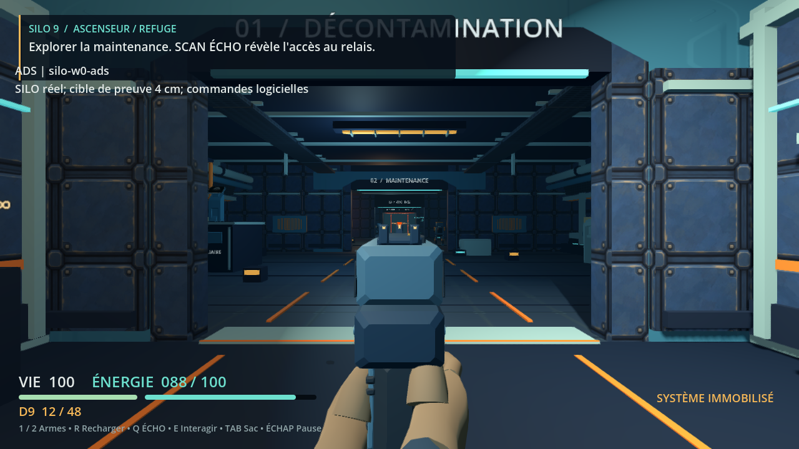
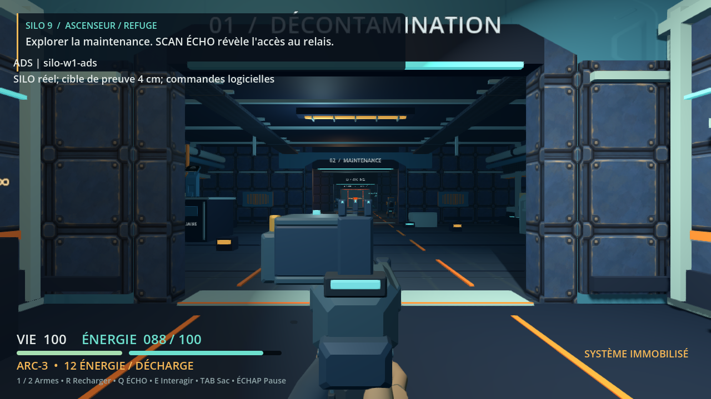

# Ticket 7 : visée et alignement des mires

Le clic droit maintenu rapproche progressivement le D9 ou l’ARC de la ligne de visée. La hausse et le guidon s’alignent sur la direction du tir ; le boîtier de l’ARC reste sous cette ligne. Le réticule s’efface pendant la transition. À pleine visée, les mouvements de marche et de caméra ne déplacent plus les mires.

R, B et les changements d’arme quittent progressivement la visée pour la manipulation, puis la rétablissent si le bouton reste tenu. Viser remplace le sprint par la marche. Après une pause, un chargement ou une nouvelle partie, il faut relâcher puis appuyer de nouveau : un bouton maintenu ne déclenche ni visée ni tir à la reprise.

| Réglage | Plage | Défaut |
|---|---|---|
| Champ de vision vertical à la hanche | 60 à 100° | 76° |
| Grossissement en visée | ×1 à ×1,6 | ×1,25 |
| Sensibilité en visée | 20 à 100 % | 65 % |

Ces options sont conservées dans `settings.cfg`, puis appliquées au joueur courant, à la nouvelle partie et au chargement. WASD et ZQSD restent disponibles. Le mapping minimal de la manette 0 ajoute les sticks, LT pour viser, RT pour tirer, A pour sauter, X pour recharger, Y pour interagir, RB pour scanner, LB/D-pad droite pour les armes et Start pour la pause. Il a été vérifié par événements logiciels, sans essai de manette physique.

## Vérification

- Les tests précèdent l’implémentation. Les nouvelles suites vérifient les mires et de vrais impacts à 3, 10 et 20 m, les deux armes, les FOV 60/76/100, les transitions, interruptions, réglages et entrées. Une régression distincte protège les taps de saut achevés entre deux ticks.
- Une campagne de **38 suites passe** avant une dernière retouche visuelle : déplacement de 9 mm de la pastille du guidon vers la face visible de son support. **Trois suites passent ensuite** sur la source finale : géométrie ADS, rig et géométrie visuelle. Les 38 suites n’ont pas toutes été relancées après cette ligne.
- La [revue de code indépendante](media/07/validation/code-review.md) ne trouve pas de défaut restant dans le delta. Elle vérifie les sources et logs archivés ; elle ne constitue pas une réexécution du jeu.
- Le [parcours natif XTest](media/07/native/verification.json) exerce réellement souris et clavier : tir D9 de 12 à 11 cartouches, R ramenant le chargeur à 12, tir ARC de 100 à 88 d’énergie, B restaurant 100 avec une cellule consommée, pause/chargement et boutons maintenus. Les options 100/1,6/0,2 sont écrites par la GUI puis relues après redémarrage. Les deux processus quittent par le menu avec code 0, sans erreur moteur.

La [matrice rendue](media/07/render/journey.json) atteint 18 tirs et 18 impacts, pour 603 dégâts. Le [film](media/07/film/ads.mp4) contient 480 images, huit tirs et 246 dégâts ; son [décodage intégral](media/07/film/decode-verification.json) passe. La [revue visuelle indépendante](media/07/validation/art-review-final.md) examine 44 captures et 264 images par blocs consécutifs. Les mains restent attachées et les mires lisibles dans ces vues. Aucune lecture continue ni écoute intégrale n’est revendiquée. Le film à 30 images/s fixes ne mesure pas les performances.

Les essais natifs invalidés par la mort du joueur ou une activation de menu ambiguë sont conservés et exclus des conclusions.

## Coût

La calibration des mires s’effectue au changement d’arme. La visée n’ajoute ni allocation de mesh/matériau par frame, ni lumière, ni requête de proximité.

Dix essais valides comparent cinq paires base/candidat en alternant leur ordre, à 1280×720, dans le SILO réel. Chaque essai effectue huit tirs, 246 dégâts, un déplacement, R et B. Les plages se recouvrent ; cette campagne ne distingue pas un surcoût de la variation entre essais.

| Version | Médiane des p50, ms | Plage des p50, ms | Médiane des p95, ms | Plage des p95, ms |
|---|---:|---|---:|---|
| Base du ticket 6 | 94,823 | 93,618 à 103,501 | 119,371 | 111,863 à 133,695 |
| Visée du ticket 7 | 94,664 | 92,953 à 96,453 | 113,132 | 108,130 à 116,632 |

Les maxima observés restent au plus 377 appels de dessin et 83 ressources. Les quatre marqueurs de mires font passer le maximum de 682 à 686 nœuds. Le [recalcul indépendant](media/07/performance/audit/report.md) détaille les [mesures brutes](media/07/performance/performance.json). Import, capture de chauffe, film et profilage sont hors de la fenêtre mesurée. Les intervalles incluent rendu, ordonnanceur et VSync ; le grossissement change aussi le volume visible. Les attentes se quantifient aux ticks et produisent de légères différences de distance parcourue. Ce protocole n’isole donc pas le seul coût du calcul de la transition.

Le renderer disponible est llvmpipe, exécuté sur CPU. Le profilage séparé attribue environ 90 % du CPU consommé aux threads llvmpipe dans les 24 échantillons centraux. Les deux versions tournent depuis les sources avec le même binaire Godot, sans export de production dans cette comparaison. Aucun débit sur GPU de jeu ni objectif de 60 images/s n’est validé par ces essais.

## Preuves et limites

La source de jeu finale est `1f36f01eea2e5d34dafee7f46a665c013370cbb4`, sur `feat/issue-07-ads`. La base comparative est `2818e15a617760dcb98b93927eb563d7af05ba17`, ticket 6. La campagne des 38 suites utilise la source précédant la seule retouche de pastille décrite ci-dessus ; les trois relances et le parcours natif utilisent la source finale.

Les [empreintes des artefacts](media/07/SHA256.json) couvrent les preuves publiées. Les rapports archivés peuvent citer les chemins de travail privés d’origine.

Le script de mesure attend la disponibilité de l’ARC avant son second tir. Un premier profil, exclu des mesures, le demandait après 0,50 s au lieu des 0,52 s nécessaires et a été correctement rejeté. Le film publié avait déjà effectué ses huit tirs à cadence fixe. Il utilise la version du script précédant cette attente, archivée à ses côtés ; la source du jeu est identique. Les assertions et quotas restent inchangés.





Exécution vérifiée sous Linux, Godot 4.7.2, X11 et OpenGL Compatibility. Windows, manette physique et GPU cible restent non testés. L’alignement ADS ne fournit pas de collision physique générale entre les armes et le décor. À 30 cm d’une paroi, le décor peut masquer toute l’arme ou couper le boîtier et le guidon. Cette limite est visible dans les captures de proximité. Aucune équivalence de finition avec Fortnite n’est revendiquée.

## Reproduire les parcours

Depuis la racine du checkout candidat, avec Godot 4.7.2, Python 3 et un affichage X11 existant ; ffmpeg permet la conversion du film en MP4 :

```sh
DISPLAY=:100 python3 tools/prove_ads.py inspection --project "$PWD" --godot /chemin/Godot --output /tmp/silo9-ads-inspection
DISPLAY=:100 python3 tools/prove_ads.py film --project "$PWD" --godot /chemin/Godot --output /tmp/silo9-ads-film
```

Pour la comparaison, créer une archive réelle du commit de base dans un nouveau dossier, avec son marqueur de révision, puis lancer la campagne :

```sh
ADS_BASELINE_DIR=$(mktemp -d /tmp/silo9-ads-baseline.XXXXXX)
git archive 2818e15a617760dcb98b93927eb563d7af05ba17 | tar -x -C "$ADS_BASELINE_DIR"
printf '%s\n' 2818e15a617760dcb98b93927eb563d7af05ba17 > "$ADS_BASELINE_DIR/.baseline-revision"
DISPLAY=:100 python3 tools/prove_ads.py perf --project "$PWD" --godot /chemin/Godot --baseline "$ADS_BASELINE_DIR" --output /tmp/silo9-ads-performance
```

Un worktree positionné sur cette même base convient aussi à `--baseline`. Chaque destination de preuve doit être nouvelle ou vide. Le runner vérifie les sources contre Git et leur stabilité pendant la campagne ; il exige un renderer X11 actif. Les parcours automatisés utilisent des entrées logicielles dans Godot et une cible de contrôle, distinctes du parcours XTest. `tools/verify.sh` exécute les suites comportementales.
