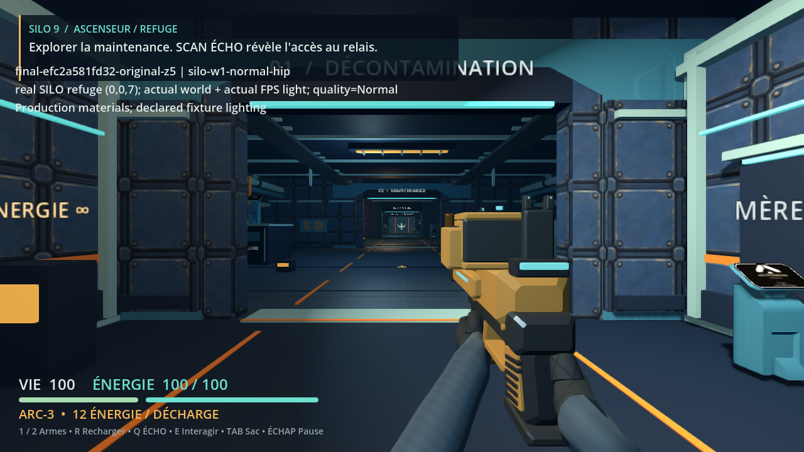
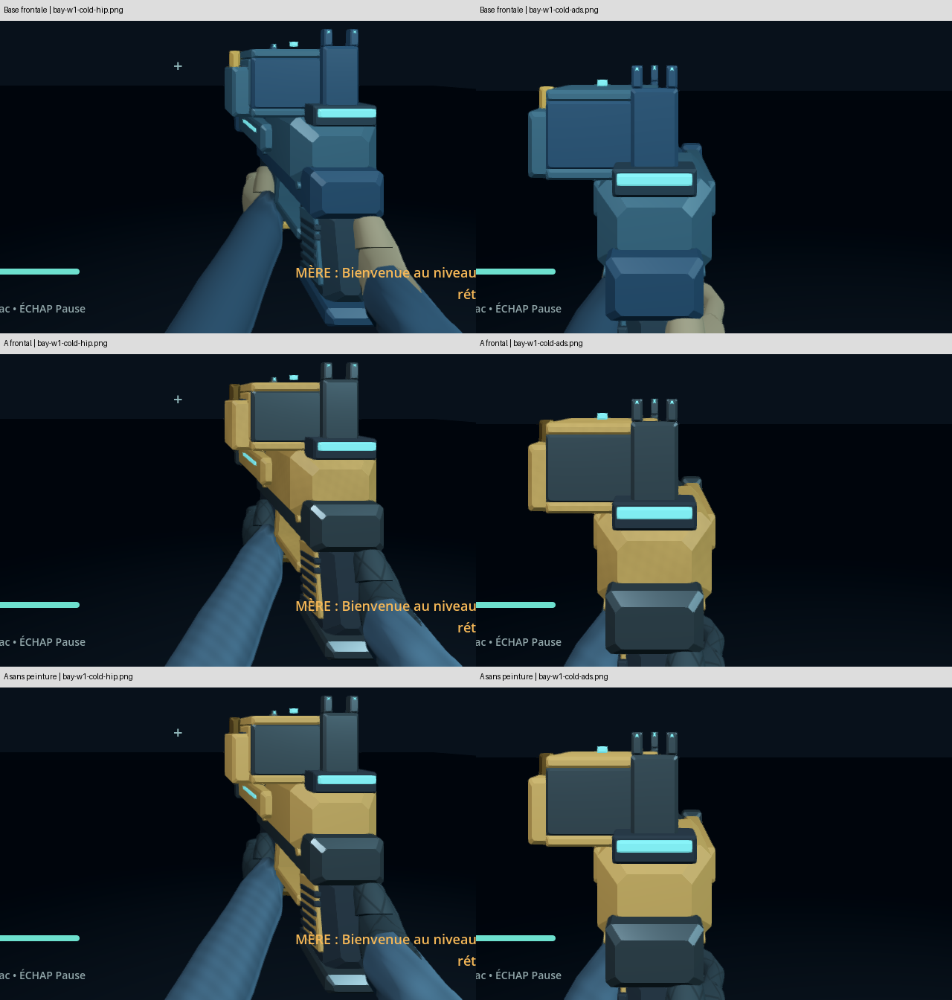

# Ticket 8 : matériaux des mains et des armes

Le D9 bleu pétrole et l’ARC ocre se distinguent davantage du décor. Les gants graphite portent un quadrillage matelassé ; les manches montrent un tissage discret. Les pièces métalliques réagissent aux lumières, tandis que la peinture et les isolants restent mats. Les mains existantes sont entièrement gantées. Aucune peau nue n’a été ajoutée.

## Choix et coût des ressources

Deux palettes ont été comparées dans le moteur, sous trois éclairages et dans le refuge en qualité Normal et Low. Une seconde série, avec la lampe de contrôle placée de face, a permis d’examiner les reflets des faces visibles. Cette lampe appartient aux sondes de vérification ; l’éclairage du jeu reste inchangé.

La palette bleu pétrole et ocre a été retenue après revue indépendante. Les cartes des gants et du tissu améliorent leur lecture. Les deux cartes de peinture ont été retirées après comparaison à paramètres identiques. Leur marbrage brouillait les grands aplats sans aider à identifier le matériau.

La géométrie des armes et des bras partage neuf ressources natives. Le rig complet utilise aussi deux matériaux d’effet de bouche hérités. Les quatre images originales de 128 × 128 utilisent des mipmaps. L’estimation conservatrice RGBA8 de la chaîne complète vaut 349 520 octets, soit environ 341 Kio. Ce nombre n’est pas une mesure de VRAM. Aucun shader personnalisé, normal map, passe supplémentaire ou lumière de production n’est ajouté.

Les UV sont créés à la construction des meshes. Ils suivent la déformation des mains sans recalcul par frame. Les ressources sont partagées et ne sont pas modifiées pendant les animations. Le générateur Python utilise uniquement sa bibliothèque standard. La [provenance](../../assets/fps/README.md) décrit les fichiers originaux sans leur attribuer une licence absente du projet.

## Vérification

Le test matériaux a d’abord produit 15 échecs sémantiques sur la base. Le parent a reproduit ces échecs avant l’implémentation. Sur la source finale `efc2a581fd329321a852507d775af6fcda0a9cb1`, les sept suites ciblées passent. Elles couvrent les matériaux, les UV, la géométrie, le rig, les deux armes, l’indicateur ARC et les mires. Les triangles développés, normales, poids d’os, transforms et marqueurs correspondent à la référence de départ.

Les changements purement visuels de palette et de textures ont été comparés par captures, selon l’exception documentée avant l’implémentation. Les tests de mapping et de ressources ont suivi le cycle rouge puis vert.

L’inspection finale fournit 17 captures du vrai jeu. Le [film](media/08/film/materials.mp4) contient six segments sous éclairages froid, rouge et faible. Les trois rechargements D9 transfèrent quatre cartouches ; les trois changements de cellule ARC font passer l’énergie de 40 à 100 en consommant une cellule. Les états de départ sont imposés et déclarés par la sonde.

Le fichier de 41,2 secondes contient 1 236 images à 30 images/s. Son décodage intégral réussit. La revue artistique indépendante a examiné six fenêtres de douze images consécutives, les treize captures du film et les dix-sept captures fixes. Aucun raccord UV manifestement fautif ni saut brutal de motif n’a été repéré dans ces fenêtres. Cela ne constitue pas un visionnage continu, une écoute ou une preuve d’absence de scintillement subtil sur tout le film.

Le premier enregistrement a été rejeté à tort par une garde de la sonde. Le parent a reproduit cet échec avant correction par un autre agent. La garde utilise maintenant l’API officielle `Engine.get_write_movie_path()` ; l’absence d’enregistreur est aussi testée. La cadence de 30 images/s est vérifiée séparément dans le fichier produit. Le jeu n’a pas été modifié pour corriger cet outil.

## Performance

Aucune différence de temps de frame n’est démontrée par les cinq paires à ordre alterné. Les plages se recouvrent. Chaque essai accomplit huit impacts et 246 dégâts, un déplacement, une recharge et un changement de cellule.

| Version | Médiane des p50, ms | Plage des p50, ms | Médiane des p95, ms | Plage des p95, ms |
|---|---:|---|---:|---|
| Base du ticket 7 | 93,027 | 90,327 à 95,993 | 110,534 | 107,561 à 115,877 |
| Matériaux du ticket 8 | 91,925 | 91,217 à 96,786 | 109,625 | 107,784 à 117,703 |

Le maximum observé reste de 377 appels de dessin et 686 nœuds. Le compteur de ressources du moteur passe de 83 à 96. Ce compteur est global au moteur et ne mesure pas les octets des textures. Les [données brutes](media/08/performance/performance.json) et leur [audit indépendant](media/08/performance/audit/report.md) permettent de contrôler ces résultats.

Le profilage séparé attribue environ 90 % du CPU consommé aux threads llvmpipe dans sa fenêtre centrale. Cette fenêtre représente les 60 % centraux des observations du profil ; elle n’est pas une délimitation instrumentée du parcours chronométré. Le rendu logiciel domine le CPU observé, sans prouver une saturation de toute la machine. Les deux versions tournent depuis les sources avec le même moteur et la même visée. La réserve générique de l’ancien runner sur un changement de zoom ne s’applique donc pas à ce ticket.

Les intervalles englobent rendu, ordonnanceur et VSync. Les délais se quantifient aux ticks, ce qui fait varier légèrement le mouvement et les phases transitoires. Import, captures de chauffe, vidéo et profilage restent hors mesure. Une première campagne a été interrompue par SIGTERM, de cause non établie ; elle est entièrement exclue. Les dix résultats publiés proviennent de cinq paires relancées séparément, avec les mêmes fonctions de mesure et les mêmes sources.

## Reproduire

Depuis la racine du projet, avec Godot 4.7.2 et un affichage X11 existant, choisir un dossier neuf pour chaque sortie.

```sh
./tools/godot.sh --headless --path . --editor --import --quit
./tools/godot.sh --headless --path . --script res://tests/test_fps_materials.gd
DISPLAY=:100 XDG_DATA_HOME=/tmp/silo9-materials-inspection/user-data timeout 360s ./tools/godot.sh --path . --display-driver x11 --rendering-method gl_compatibility --audio-driver Dummy --resolution 1280x720 --script tools/probe_fps_materials.gd -- --proof-output=/tmp/silo9-materials-inspection --probe-mode=inspection
```

L’outil publié place la lampe de laboratoire en Z=8, comme le film final. Les dix-sept captures fixes archivées utilisent la variante originale en Z=5, conservée dans `media/08/inspection/probe-at-launch.gd`. Pour reproduire exactement leur éclairage, utiliser ce script à la place de l’outil public dans la commande d’inspection.

Pour enregistrer un film frontal, créer un dossier neuf avant de lancer Movie Maker. La sonde vérifie que Movie Maker est actif ; la cadence est imposée par la commande puis vérifiée dans le fichier vidéo.

```sh
mkdir /tmp/silo9-materials-film
DISPLAY=:100 XDG_DATA_HOME=/tmp/silo9-materials-film/user-data timeout 360s ./tools/godot.sh --path . --display-driver x11 --rendering-method gl_compatibility --audio-driver Dummy --resolution 1280x720 --write-movie /tmp/silo9-materials-film/materials.avi --fixed-fps 30 --script tools/probe_fps_materials.gd -- --proof-output=/tmp/silo9-materials-film --probe-mode=film
ffprobe -v error -select_streams v:0 -show_entries stream=width,height,avg_frame_rate,nb_frames /tmp/silo9-materials-film/materials.avi
```

La sonde charge le vrai jeu et conserve ses matériaux. Son laboratoire et ses commandes automatisées sont déclarés dans les résultats. Les rotations caméra sont pilotées directement ; déplacement et visée utilisent des entrées logicielles. Le film à cadence imposée n’est pas une mesure de performance.

Le parcours de coût se reproduit avec l’outil ADS existant et une archive du commit de base. Le dossier de sortie doit être neuf.

```sh
MATERIAL_BASELINE_DIR=$(mktemp -d /tmp/silo9-materials-base.XXXXXX)
git archive 98f2d4a735d7c2fe1ad6f3d8431ab86772db1e8a | tar -x -C "$MATERIAL_BASELINE_DIR"
printf '%s\n' 98f2d4a735d7c2fe1ad6f3d8431ab86772db1e8a > "$MATERIAL_BASELINE_DIR/.baseline-revision"
DISPLAY=:100 python3 tools/prove_ads.py perf --project "$PWD" --godot "$PWD/.tools/Godot_v4.7.2-stable_linux.x86_64" --baseline "$MATERIAL_BASELINE_DIR" --output /tmp/silo9-materials-performance
```

Les manifestes historiques conservent les chemins du workspace où les preuves ont été produites. Les [empreintes publiées](media/08/SHA256.json) couvrent leurs fichiers. Les commandes ci-dessus sont les procédures à utiliser dans un nouveau checkout.





Les essais sont exécutés sous Linux avec llvmpipe. Windows, manette physique, GPU de jeu et équivalence de finition avec Fortnite ne sont pas validés par ce ticket. Les collisions de proximité entre arme et mur restent celles documentées au ticket 7.
